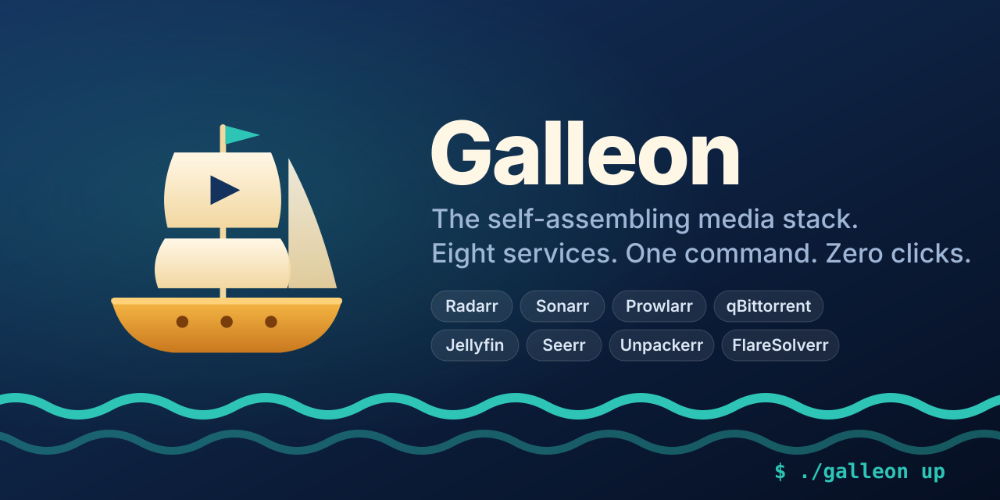
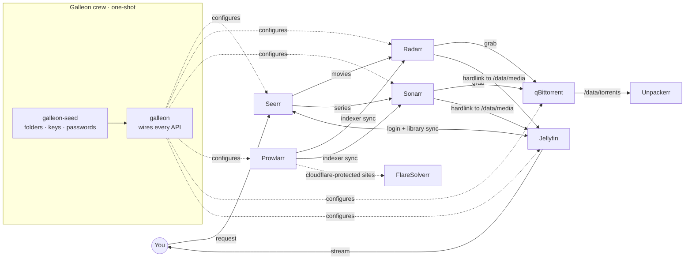

<p align="center">
  
</p>

<p align="center">
  <a href="https://github.com/sponsors/ironblaster"></a>
  <a href="https://ko-fi.com/ironblaster"></a>
</p>

<p align="center">
  <a href="https://github.com/ironblaster/galleon/actions/workflows/ci.yml"></a>
  <a href="https://github.com/ironblaster/galleon/actions/workflows/security.yml"></a>
  <a href="https://github.com/ironblaster/galleon/actions/workflows/codeql.yml"></a>
  <a href="https://scorecard.dev/viewer/?uri=github.com/ironblaster/galleon"></a>
  <br>
  <a href="https://github.com/ironblaster/galleon/releases"></a>
  <a href="LICENSE"></a>
  
  
  <a href="https://github.com/ironblaster/galleon/stargazers"></a>
</p>

<p align="center">
  <b>Radarr · Sonarr · Prowlarr · qBittorrent · Jellyfin · Seerr · Unpackerr · FlareSolverr</b><br>
  installed, <i>introduced to each other</i>, and ready to use — in one command.
</p>

<p align="center">
  <a href="#-quick-start"><b>Quick start</b></a> ·
  <a href="#-what-you-get"><b>Features</b></a> ·
  <a href="#%EF%B8%8F-how-it-sails"><b>How it works</b></a> ·
  <a href="docs/configuration.md"><b>Configuration</b></a> ·
  <a href="#%EF%B8%8F-built-like-a-warship"><b>Security</b></a> ·
  <a href="#-support-the-voyage"><b>Sponsor</b></a>
</p>

---

Setting up a home media server usually means installing eight apps, then spending an evening copying API keys between them, pointing download clients at the right ports, creating root folders, fixing hardlinks and clicking through four setup wizards.

**Galleon does all of that for you.** It pre-seeds every service with keys and credentials before it boots, then a small helmsman container walks each API and wires the fleet together. When `./galleon up` finishes, you open Seerr, request a movie, and it shows up in Jellyfin.

```bash
git clone https://github.com/ironblaster/galleon && cd galleon
./galleon init     # 8 questions, all with sensible defaults
./galleon up       # ☕ about 3 minutes later (plus image download): all hands on deck
```

```
⛵  Galleon · assembling the fleet
━━ Radarr · movies
  ✔ Radarr: login 'admin' (no password needed on your LAN)
  ✔ Radarr: root folder /data/media/movies
  ✔ Radarr: hardlinks on, clean renaming on
  ✔ Radarr: downloadclient 'qBittorrent' added
  ✔ Radarr: every quality profile prefers Italian audio (+100)
━━ Prowlarr · indexers
  ✔ Prowlarr: indexerproxy 'FlareSolverr' added
  ✔ Prowlarr: applications 'Radarr' added
  ✔ indexer '1337x' via FlareSolverr
  ✔ indexer 'Nyaa.si'
  ✔ 13/13 indexers aboard
━━ Jellyfin · streaming
  ✔ Jellyfin: wizard done, admin 'admin'
  ✔ Jellyfin: library 'Film' → /data/media/movies
━━ Seerr · requests
  ✔ Seerr: linked to Jellyfin, admin 'admin'
  ✔ Seerr: radarr connected (profile 'HD-1080p')
  ✔ Seerr: setup complete

⛵  All hands on deck in 187s
```
<sub>Real output from a clean first run (<code>GALLEON_LANGUAGE=it</code>, presets <code>public-general,public-anime</code>). Re-running <code>./galleon bootstrap</code> takes ~40s and changes nothing.</sub>

## ✨ What you get

| | |
|---|---|
| 🔑 **Zero copy-paste** | API keys are generated by `init` and injected into every config *before first boot*. No service ever shows you a key you need to paste somewhere else. |
| 🧭 **Fully wired** | Prowlarr → Radarr/Sonarr sync, qBittorrent as download client with categories, Seerr → Radarr/Sonarr, Seerr ↔ Jellyfin login, Unpackerr watching both. |
| 🔗 **Hardlinks that just work** | One `/data` tree laid out per the [TRaSH Guides](https://trash-guides.info/File-and-Folder-Structure/). Imports are instant and use no extra disk, and seeding keeps going. `init` checks this for you. |
| 👤 **One login** | The same admin user on qBittorrent, Radarr, Sonarr, Prowlarr, Jellyfin and Seerr. On your LAN the *arr apps skip the login entirely. |
| 🌍 **Speaks your language** | `GALLEON_LANGUAGE=it` gives you Italian Jellyfin metadata and library names, the Seerr UI in Italian, and Radarr/Sonarr profiles that prefer Italian audio. Supported: en, it, de, fr, es, pt, nl, pl. |
| 🗺️ **Indexer presets** | Opt-in YAML presets (public, anime, private-by-country). FlareSolverr is attached only to indexers that need it. |
| 🚚 **Bring your own indexers** | `./galleon export-indexers` copies the indexers from your *existing* Prowlarr into a preset and strips every password, cookie and API key. |
| ♻️ **Idempotent** | Every step checks what's already there. Re-run `./galleon bootstrap` whenever you like: it fixes drift and never duplicates anything. |
| 🛡️ **Optional VPN** | `GALLEON_VPN=true` sends qBittorrent's traffic through [Gluetun](https://github.com/qdm12/gluetun). It supports 30+ providers and has a built-in kill switch. |
| 🎞️ **Optional extras** | Intel/AMD hardware transcoding (`GALLEON_GPU=true`) and TRaSH quality profiles that stay in sync through Recyclarr (`GALLEON_TRASH=true`). |

## 🗺️ How it sails



Two short-lived containers do the work:

1. **`galleon-seed`** runs before anything else. It creates the folder tree, writes `config.xml` with your API keys into Radarr/Sonarr/Prowlarr, writes a PBKDF2-hashed WebUI password into qBittorrent, and checks that hardlinks work.
2. **`galleon`** (the helmsman) waits for every service to become healthy, then configures each one over its own public API, in dependency order. If one step fails, the others still run, and the summary tells you what to re-run.

Both exit when they're done. What keeps running is just the upstream images: `lscr.io/linuxserver/*`, `jellyfin/jellyfin`, `ghcr.io/seerr-team/seerr`, and so on. Galleon doesn't fork or patch them, so nothing ties you to Galleon.

## 🚀 Quick start

**Requirements:** Docker Engine 24+ with Compose v2.20+ (v2.24+ for the optional VPN), Linux or macOS (NAS boxes like Synology, Unraid, TrueNAS and TerraMaster work too), about 4 GB of RAM.

```bash
git clone https://github.com/ironblaster/galleon && cd galleon
./galleon init
./galleon up
./galleon urls     # where is everything + your login
```

Then open **Seerr** (`http://<host>:5055`), sign in with the admin user, and request something.

<details>
<summary><b>Non-interactive install (CI, Ansible, scripts)</b></summary>

```bash
./galleon init --yes            # accept every default
sed -i 's/^GALLEON_INDEXER_PRESETS=.*/GALLEON_INDEXER_PRESETS=public-general/' .env
./galleon up
```
</details>

## 🧰 Commands

| Command | What it does |
|---|---|
| `./galleon init` | Interactive setup. Writes `.env` (chmod 600) with generated keys and password |
| `./galleon up` | Starts the fleet and runs the auto-configuration |
| `./galleon urls` | Prints every web UI and the login |
| `./galleon status` | Shows container state and health |
| `./galleon logs [svc]` | Follows the logs |
| `./galleon bootstrap` | Re-runs the auto-configuration (safe to repeat) |
| `./galleon export-indexers --url … --api-key …` | Imports indexers from another Prowlarr, without secrets |
| `./galleon update` | Pulls new images and recreates the containers |
| `./galleon doctor` | Checks Docker, ports, disk space and hardlinks |

## 🗂️ Folder layout

```
data/                      ← GALLEON_DATA_DIR (one filesystem!)
├── torrents/
│   ├── movies/            ← qBittorrent category "radarr"
│   └── tv/                ← qBittorrent category "sonarr"
└── media/
    ├── movies/            ← Radarr root folder · Jellyfin library
    └── tv/                ← Sonarr root folder · Jellyfin library
config/                    ← GALLEON_CONFIG_DIR, one folder per service
```

## 🏴‍☠️ Indexer presets

Presets are plain YAML files in [`presets/indexers/`](presets/indexers). Turn them on with a comma-separated list:

```ini
GALLEON_INDEXER_PRESETS=public-general,public-anime,custom
```

| Preset | Contents |
|---|---|
| `public-general` | 1337x, The Pirate Bay, YTS, EZTV, LimeTorrents, KickassTorrents, uIndex, TorrentDownloads, Knaben |
| `public-anime` | Nyaa, TokyoTosho, AnimeTosho, SubsPlease |
| `private-it` | Il Corsaro Blu. It's added only if you put your account in `.env` |
| `custom` | Whatever `./galleon export-indexers` saved to `config/galleon/indexers.yml` |

A preset entry looks like this:

```yaml
- definition: 1337x        # Prowlarr definition id
  flaresolverr: true       # route through FlareSolverr
  priority: 25
  settings:                # optional per-indexer fields
    username: ${GALLEON_IDX_MYTRACKER_USERNAME}   # resolved from .env, never stored here
```

Want to share your preset? PRs with new presets are welcome. They must not contain credentials, and CI checks that.

## 🔒 Security notes

- `.env` holds every secret. It's created with `chmod 600` and is in `.gitignore`.
- The *arr apps use **Forms** login, *disabled for local addresses*. To expose them to the internet, put a reverse proxy with authentication in front, or use Tailscale or Cloudflare Tunnel.
- The exporter strips any field that is marked private or whose name looks like a secret (`pass`, `key`, `cookie`, `token`, `user`, `pid`, …). It replaces each value with a `${GALLEON_IDX_*}` placeholder.

## ❓ FAQ

<details><summary><b>I already run some of these apps. Will Galleon overwrite them?</b></summary>

Galleon only creates configs that don't exist yet. To migrate, point `GALLEON_CONFIG_DIR` at a fresh folder and use `export-indexers` to bring your indexers over. Your media folders are never chowned or moved.
</details>

<details><summary><b>Why Jellyfin and not Plex?</b></summary>

Jellyfin is open source and can be configured completely offline through its API. Plex has to be claimed through plex.tv. Plex support is planned as an optional profile. See the [roadmap](#-roadmap).
</details>

<details><summary><b>Can I change the quality profile Seerr uses?</b></summary>

Set `GALLEON_QUALITY_PROFILE` to the name of a Radarr/Sonarr profile and run `./galleon bootstrap`. If you enabled `GALLEON_TRASH=true`, the TRaSH profiles appear after Recyclarr's first sync.
</details>

<details><summary><b>An indexer was skipped with "unable to connect"</b></summary>

Some ISPs block torrent sites at the DNS level. Galleon warns you and keeps going. Fix your DNS (for example DNS-over-HTTPS on the router) or enable the VPN, then run `./galleon bootstrap` and the missing indexers will be added.
</details>

<details><summary><b>I open Radarr through a hostname and it asks for a password</b></summary>

For password-less LAN access, the *arr apps only trust the host names in their *Allowed Hosts* list (this protects against DNS rebinding). Galleon adds `localhost`, the container name and `GALLEON_HOST` to that list. Put any other names in `GALLEON_ALLOWED_HOSTS=nas.local,media.home` and run `./galleon bootstrap`.
</details>

<details><summary><b>Does it work on ARM (Raspberry Pi, Apple Silicon)?</b></summary>

Yes. Every image in the stack is multi-arch (amd64 + arm64), and the voyage test is also run on Apple Silicon.
</details>

## 🛡️ Built like a warship

Galleon runs with admin rights on your server, so trust matters. Every pull request has to pass these gates before it can be merged, and every gate is enforced by branch protection, not by goodwill:

| Gate | What it catches |
|---|---|
| 🧪 **Voyage test** | Boots all eight services on a clean runner and asserts every link (15 checks). Then it runs the bootstrap a second time to prove it's idempotent |
| 🔬 **CodeQL** (`security-and-quality`) | Injection, unsafe deserialization and logic bugs in Python and in the workflows themselves |
| 🔑 **Gitleaks** | Any credential committed by mistake, anywhere in the git history |
| 📦 **Dependency review** | New dependencies with known CVEs (moderate+) or incompatible licenses |
| 🐳 **Trivy** | Vulnerabilities, secrets and misconfigurations in the image and in the compose files |
| ⚙️ **zizmor** (pedantic) | Insecure GitHub Actions patterns: template injection, over-broad tokens, unpinned actions |
| 🧹 **ruff · shellcheck · hadolint** | Python, Bash and Dockerfile quality |
| 🏷️ **Conventional PR titles** | A readable history and an automatic changelog |
| 👀 **Code-owner review** | A maintainer approves every change. CI, the CLI, `core/` and the presets are owned explicitly |

The supply chain is hardened as well:
- **Pinned everything:** every Action is pinned to a full commit SHA, the base image to a digest, and the Python dependencies to hashes (`pip --require-hashes`). Dependabot keeps them fresh.
- **Least privilege:** every workflow starts from `permissions: {}`, and checkouts never keep the token. Pull requests from forks run with no secrets, and a maintainer has to approve them before they run.
- **Signed releases:** the `galleon` image is built for amd64 and arm64 with SBOM and SLSA provenance, and signed keylessly with Sigstore cosign. You can verify it:

  ```bash
  cosign verify ghcr.io/ironblaster/galleon:latest \
    --certificate-identity-regexp 'https://github.com/ironblaster/galleon/' \
    --certificate-oidc-issuer https://token.actions.githubusercontent.com
  ```
- **Unprivileged at runtime:** the helmsman runs as your `PUID`. Only the one-shot seed step runs as root, once, to chown the folders it creates.

Found a vulnerability? Please report it [privately](SECURITY.md).

## 🧭 Roadmap

- [ ] Optional Plex profile (claim token flow)
- [ ] Bazarr with subtitle-language presets
- [ ] Optional reverse proxy (Caddy) with automatic HTTPS and SSO
- [ ] Usenet: SABnzbd profile
- [ ] Homepage dashboard, auto-populated with widgets and keys
- [ ] Prebuilt `galleon` image on GHCR, signed with cosign

## 🤝 Contributing

Issues and PRs are welcome. See [CONTRIBUTING.md](CONTRIBUTING.md). The CI "voyage test" boots the whole fleet on every PR and asserts that every link is in place.

## ☕ Support the voyage

Galleon is free and always will be. If it saved you an evening of copy-pasting API keys, you can help keep the ship afloat:

<p>
  <a href="https://github.com/sponsors/ironblaster"></a>
  <a href="https://ko-fi.com/ironblaster"></a>
</p>

A ⭐ on the repo helps too: it's how other people find Galleon.

## ⚖️ Legal

Galleon is an installer and configurator for free, open-source software. It doesn't host, index or distribute any content. Indexer presets are **disabled by default**. You are responsible for what you download and for complying with the laws of your country.

<p align="center"><sub>Made with ⛵ by <a href="https://github.com/ironblaster">@ironblaster</a> · MIT licensed · not affiliated with the Servarr, Jellyfin or Seerr projects</sub></p>
